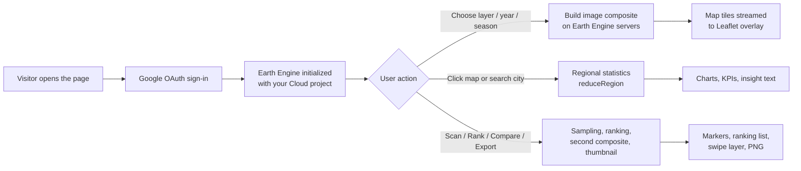

# 🛰️ Earth Lab Tunisia

**An interactive satellite explorer for urban heat, vegetation and city growth across Tunisia.**
Built as a single `index.html` file, powered by Google Earth Engine and Leaflet, and hosted for free on GitHub Pages.

---

## ✨ What it does

Pick a layer, choose a year and season, then click anywhere on the map. Earth Lab Tunisia turns raw Landsat and Dynamic World imagery into maps, trends and insights in seconds, with no software to install.

### Map layers

| Layer | What it shows | Source |
|---|---|---|
| 🌡 **Heat** | Land surface temperature (°C) | Landsat 8/9 thermal band |
| 🌿 **Green** | Vegetation health (NDVI) | Landsat 8/9 red + near-infrared |
| 🏙 **Built-up** | Urban footprint for a chosen year | Dynamic World (class: built) |
| ✦ **Growth** | New built-up area since 2016 | Dynamic World change detection |
| 💧 **Water** | Water and moisture (NDWI) | Landsat 8/9 green + near-infrared |
| 🧱 **Bare/Urban** | Bare and built surfaces (NDBI) | Landsat 8/9 SWIR + near-infrared |

### Analysis tools

- **Location analysis**: click the map or search a city to get a 2014–2025 trend of temperature and vegetation, warming and greening per decade, built-up area in 2016 versus the selected year, and the percentage of urban growth.
- **Heat-island intensity**: compares the mean temperature inside your chosen radius with the surrounding ring, so you can see how much hotter the urban core is than its outskirts.
- **Hotspot scan**: samples the visible map area and marks the warmest pixels. Each marker has an *Analyze this site* button.
- **City heat ranking**: ranks 25 Tunisian cities by land surface temperature for the selected year and season. Tap a city to analyze it.
- **Earth Intelligence card**: turns the numbers into a plain-language insight for the current view.

### Exploration tools

- **Compare years**: a before/after swipe slider with two years side by side.
- **Play years**: a time-lapse that steps through 2014–2025, advancing only after each year's tiles have loaded.
- **Tunisia flyover**: an animated tour from the northern coast to the southern desert.
- **City search and chips**: 25 cities covering most governorates, accent-insensitive search.
- **My location**: jump to your position and analyze it.
- **Basemaps**: Satellite (default), OpenStreetMap and Topography.
- **Opacity, season and radius controls**: Summer, Spring, Autumn or Full year, with 1, 3 or 5 km analysis radius.

### Export and sharing

- **Trend CSV**: yearly mean temperature and NDVI for the analyzed location.
- **Map PNG**: a 1400 px image of the visible area with the active layer.
- **Share link**: copies a URL that restores the exact view, layer, year and season.

### Built for every screen

Responsive layout with a collapsible bottom sheet on phones, a compact attribution button, and a loading indicator that reports progress whenever Earth Engine is working.

---

## 🔄 Data workflow



### 1. Authentication and startup
1. The page loads Leaflet, then the Earth Engine JavaScript client (with CDN fallbacks).
2. It signs the visitor in with Google OAuth using the Client ID and registers the Earth Engine Cloud project.
3. A status pill shows the connection state; a diagnostics log is available by tapping it.

### 2. Building a satellite composite
All heavy computation runs on Google's servers, so the browser only receives finished tiles and numbers.

1. **Collection**: Landsat 8 and Landsat 9 Collection 2 Level 2 are merged and filtered by year, season (month range) and the bounds of Tunisia.
2. **Cloud masking**: the `QA_PIXEL` band removes cloud, dilated cloud, cirrus and cloud-shadow pixels.
3. **Scaling**:
   - Surface temperature: `ST_B10 × 0.00341802 + 149` converted from Kelvin to °C
   - Surface reflectance: `SR × 2.75e-5 − 0.2`
4. **Indices**: NDVI, NDWI and NDBI are computed from the scaled bands.
5. **Median composite**: the per-pixel median gives a clean, representative image for the selected period.

### 3. Built-up and growth layers
- Dynamic World's yearly most-frequent land-cover label is taken, and class 6 is extracted as **built-up**.
- **Growth** is the area that is built in the selected year but was not built in 2016.

### 4. Rendering on the map
The chosen image is styled with a palette and value range, registered with Earth Engine (`getMap`), and added as a Leaflet tile layer. The previous layer is swapped out only after the new tiles have finished loading, which keeps playback smooth.

### 5. Location analysis
When you click a point:
1. A circular buffer (1, 3 or 5 km) is created around it.
2. For each year from 2014 to 2025, the mean temperature and NDVI inside the buffer are computed.
3. A least-squares trend line gives **warming and greenness per decade**.
4. Built-up area is summed for 2016 and the selected year to give **km² and % growth**.
5. The mean temperature inside the buffer is compared with a surrounding ring (up to three times the radius) to give the **heat-island intensity**.
6. Results render as sparklines, KPI cards and an insight sentence, and are available as CSV.

### 6. Hotspots, ranking and comparison
- **Hotspot scan**: samples 160 clear pixels in the visible area, sorts by temperature and marks the warmest six.
- **City ranking**: averages temperature in a 3 km buffer around each of the 25 city centres and sorts them.
- **Compare years**: loads a second composite for the left-hand year and clips it at the slider position over the main layer.

### 7. Export
- **CSV** is generated in the browser from the analysis results.
- **PNG** is produced by Earth Engine (`getThumbURL`) for the visible bounds.
- **Share links** encode the view in the URL query string.

---

## 🧰 Tech stack

| Part | Technology |
|---|---|
| Satellite processing | [Google Earth Engine](https://earthengine.google.com/) (JavaScript client API) |
| Imagery | USGS Landsat 8/9 Collection 2 Level 2, Google/WRI Dynamic World v1 |
| Mapping | [Leaflet](https://leafletjs.com/) 1.9 |
| Basemaps | Esri World Imagery, OpenStreetMap, Esri World Topo |
| Preview mode | NASA GIBS MODIS land surface temperature |
| Hosting | GitHub Pages (static, single file) |
| Fonts | Fraunces, DM Sans |

---

## 🚀 Setup

### 1. Earth Engine and Google Cloud
1. Create a project at [console.cloud.google.com](https://console.cloud.google.com) and note the **Project ID**.
2. Register the project for Earth Engine at [code.earthengine.google.com/register](https://code.earthengine.google.com/register).
3. Enable the **Earth Engine API** under *APIs & Services → Library*.
4. Configure the **OAuth consent screen** (External) and add your Google account as a test user.
5. Create an **OAuth client ID** of type *Web application* and add these Authorized JavaScript origins:
   - `https://YOURNAME.github.io`
   - `http://localhost:8000`

### 2. Configure the app
Open `index.html` and edit the settings block at the top:

```js
window.GEE_INLINE = {
  clientId: "YOUR_CLIENT_ID.apps.googleusercontent.com",
  project:  "your-cloud-project-id",
  tokenEndpoint: "", eeLib: ""   // optional
};
```

### 3. Deploy on GitHub Pages
1. Add `index.html` (and this README) to your repository.
2. Go to **Settings → Pages**, select the branch and `/ (root)`, then save.
3. Open `https://YOURNAME.github.io/REPO-NAME/`.

### Run locally
```bash
python3 -m http.server 8000
# then open http://localhost:8000
```

---

## 🔗 URL parameters

Share a precise view by adding query parameters:

| Parameter | Meaning | Example |
|---|---|---|
| `lat`, `lng` | Map centre (also triggers an analysis there) | `lat=36.80&lng=10.18` |
| `z` | Zoom level | `z=12` |
| `layer` | `lst`, `ndvi`, `built`, `growth`, `ndwi`, `ndbi` | `layer=growth` |
| `y` | Year, 2014–2025 | `y=2023` |
| `s` | Season: `6-8`, `3-5`, `9-11`, `1-12` | `s=6-8` |

Example: `?lat=36.80&lng=10.18&z=12&layer=lst&y=2024&s=6-8`

---

## 📁 Project structure

```
.
├── index.html   # the entire app: UI, styles and logic
└── README.md
```

---

## 🙏 Credits

- Landsat imagery courtesy of the U.S. Geological Survey and NASA
- Dynamic World by Google and the World Resources Institute
- Basemaps by Esri and © OpenStreetMap contributors
- Preview layer from NASA GIBS
- Powered by Google Earth Engine and Leaflet
